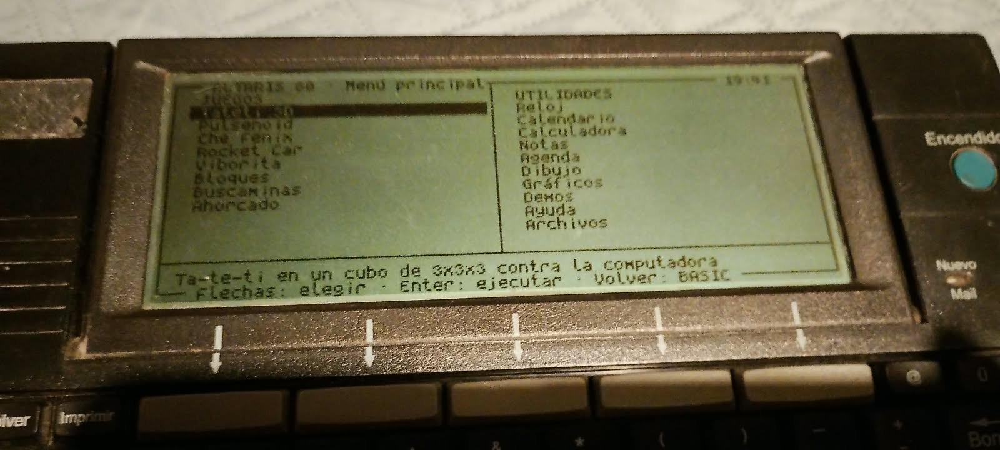
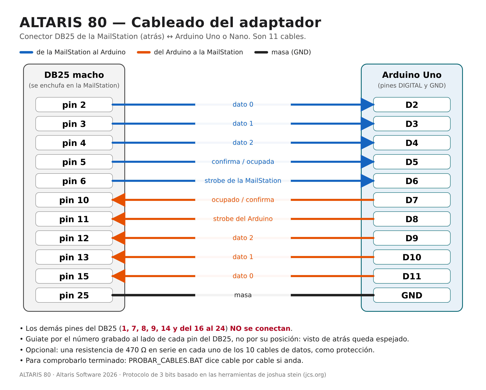
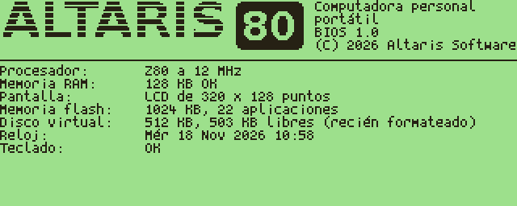
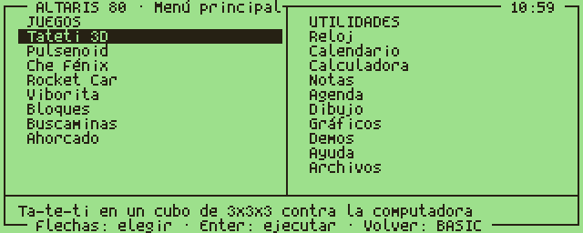
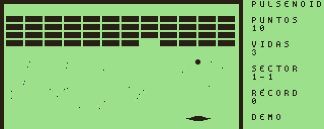
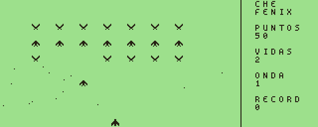
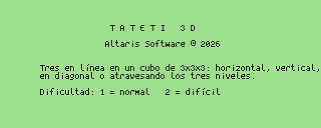
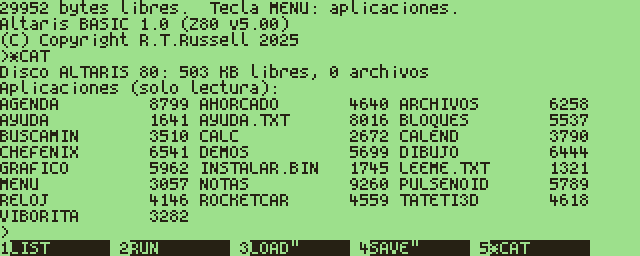
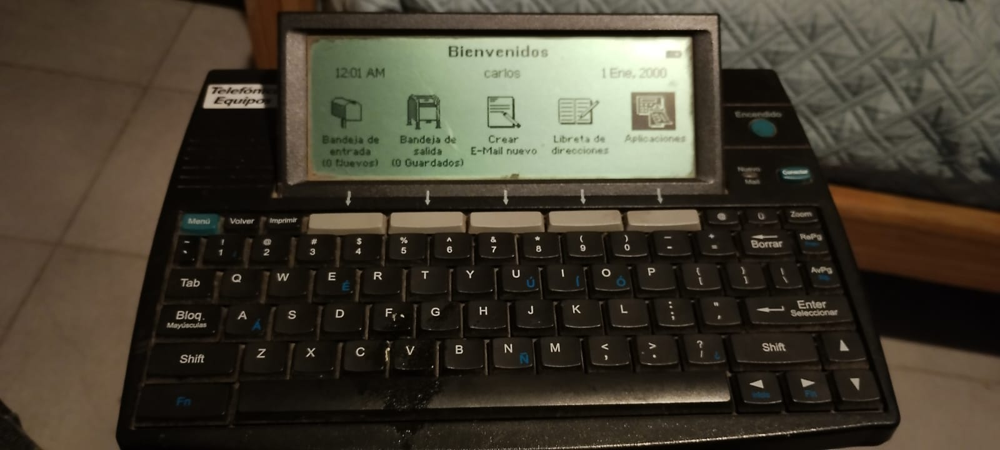

# ALTARIS 80

**Una computadora de los años 80 hecha con una terminal de correo que iba a la basura.**

La MailStation es una terminal para mandar mails por la línea de teléfono. La fabricaba CIDCO y en la Argentina la vendió Telefónica Equipos. Hoy ya no sirve para lo que fue hecha.

ALTARIS 80 reemplaza su programa interno y la convierte en una computadora personal estilo años 80: al prenderla muestra el logo, cuenta la memoria y queda lista en BASIC, como las máquinas de antes.

**Se instala sin abrir la máquina y sin soldar**: por el conector de impresora de atrás, con un Arduino Uno conectado a la PC.

## Qué trae

- BASIC con números de línea y gráficos (basado en el BBC BASIC Z80 de R. T. Russell)
- Disco interno de unos 500 KB para guardar programas y textos
- 8 juegos: Tateti 3D, Pulsenoid, Che Fénix, Rocket Car, Viborita, Bloques, Buscaminas y Ahorcado
- 10 utilidades: Reloj, Calendario, Calculadora, Notas, Agenda, Dibujo, Gráficos, Demos, Ayuda y Archivos
- Intercambio de archivos con la PC
- Actualizaciones por el mismo cable, sin volver a empezar

## Descargar

Con el botón verde **Code → Download ZIP** de esta página se baja todo, listo para usar. Adentro, empezá por `LEEME_PRIMERO.txt`.

También está en Google Drive: **[ALTARIS80_v1.0.zip](https://drive.google.com/file/d/19bY193As7R7ny0S2XG2hTsRr9W_RtGOo/view?usp=drivesdk)** (el mismo contenido).

## Qué hace falta

- Una MailStation (probado con la de Telefónica Equipos, modelo DET1, firmware 1.03), con su fuente de alimentación
- Un Arduino Uno (o Nano) con su cable USB
- Un conector DB25 macho con bornera de tornillos y 11 cables dupont
- Una PC con Windows, Linux o Mac, con Python 3

## Cómo se instala

Todo el paso a paso está en [MANUAL.txt](MANUAL.txt). En resumen:

1. Tipear el **Loader** (97 bytes) en el editor escondido de la MailStation. Se hace una sola vez.
2. Armar el cable: 11 cables entre el DB25 y el Arduino.
3. Cargarle al Arduino el programa **MS_Link**.
4. Instalar Python y pyserial en la PC.
5. Doble clic en `INSTALAR_DIRECTO.BAT` (o `INSTALAR.BAT`, que antes guarda una copia del firmware original para poder volver atrás).

Si algo no anda, `PROBAR_CABLES.BAT` revisa el cable, uno por uno, y la comunicación completa.

## El cableado

## Pantallas

| | |
|---|---|
|  |  |
| Arranque: logo y prueba de memoria | Menú de juegos y utilidades |
|  |  |
| Pulsenoid | Che Fénix |
|  |  |
| Tateti 3D | El disco interno y el de aplicaciones |

Antes de ALTARIS 80, con el firmware original:

## Cómo funciona

[COMO_FUNCIONA.txt](COMO_FUNCIONA.txt) explica, para curiosos, docentes y alumnos, qué hay adentro de la MailStation (Z80 a 12 MHz, 128 KB de RAM, 1 MB de flash), cómo se le cambia el programa sin abrirla, el protocolo de 3 bits por el puerto de impresora y la falla de sincronización entre el Arduino y la MailStation que más costó encontrar.

## Qué hay en el repositorio

| | |
|---|---|
| `MANUAL.txt` | el paso a paso completo, el uso y la solución de problemas |
| `COMO_FUNCIONA.txt` | la explicación técnica |
| `ALTARIS80.BIN` | el sistema completo, listo para grabar |
| `INSTALAR.BIN`, `CABLES.BIN` | el instalador y la prueba de cables, que corren en la MailStation |
| `*.BAT` | los programas para hacer doble clic en Windows |
| `MS_Link/` | el programa del Arduino (código y ya compilado) |
| `pc/` | el programa de la PC (Python) |
| `programas/` | los juegos y utilidades en BASIC, como texto |
| `fuente/` | el código fuente completo de ALTARIS 80 ([cómo compilarlo](fuente/COMO_COMPILAR.txt)) |
| `imagenes/` | fotos de la máquina real y pantallas |

No incluye el firmware original de CIDCO / Telefónica: no hace falta, y no se puede compartir porque no es nuestro.

## Advertencia

Instalar ALTARIS 80 reemplaza el programa interno de la MailStation. Si se corta la energía justo mientras se graba, la máquina puede quedar sin arrancar, y entonces solo se recupera con un grabador de memorias externo. Con la fuente conectada (y las pilas puestas) no pasa. Cada uno lo hace bajo su propia responsabilidad.

## Créditos y licencias

ALTARIS 80 © 2026 Carlos de la Fuente — Altaris Software. Se puede usar, copiar, estudiar, modificar y compartir libremente, nombrando el origen.

- **BBC BASIC (Z80)** © R. T. Russell (licencia zlib)
- **Letras Spleen** © Frederic Cambus (licencia BSD de 2 cláusulas)
- **Protocolo de 3 bits, adaptador y Loader**: basados en las [herramientas para la MailStation de joshua stein](https://github.com/jcs/mailstation-tools), FyberOptic y Cyrano Jones

Los textos completos están en [LICENCIAS.txt](LICENCIAS.txt).

Contacto: Altaris2000@yahoo.com.ar
